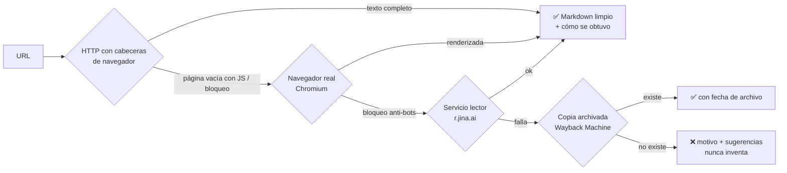

<p align="center">
  
</p>

<h1 align="center">Web Research Pro</h1>

<p align="center">
  <b>Un skill (y plugin) de Claude Code que investiga en internet de verdad:</b><br>
  lee páginas con JavaScript, esquiva bloqueos de forma legítima, entra con <i>tus</i> cuentas,<br>
  lee PDFs completos, rastrea webs enteras, vigila cambios y busca en varios motores.<br>
  Una alternativa a WebFetch y WebSearch que devuelve el texto completo, no un resumen.
</p>

<p align="center">
  <a href="https://github.com/mohaaa012/web-research-pro/actions/workflows/ci.yml"></a>
  
  
  
</p>

<p align="center"><a href="README.en.md">English version</a></p>

---

## ¿Para qué sirve?

Las herramientas web que trae Claude (WebFetch y WebSearch) se quedan cortas en muchos casos reales. Este skill las supera:

| Problema con las herramientas normales | Qué hace Web Research Pro |
|---|---|
| Páginas hechas con JavaScript (apps, paneles, tiendas, Roblox...) llegan **vacías** | Las abre en un **navegador real** (Chromium) y espera a que se pinten |
| La web **bloquea** las peticiones automáticas (403) | Escala sola: petición de navegador → navegador real → servicio lector → **copia archivada** en Wayback Machine |
| WebFetch devuelve un **resumen** hecho por un modelo pequeño, y se pierden cifras y tablas | Devuelve el **texto completo**, con tablas, enlaces y bloques de código |
| Los **PDF** comprimidos no se pueden leer | Extrae el texto de todas las páginas, con marcas de página para citar |
| Contenido detrás de **tu login** (paneles, pedidos, estadísticas) | Usa **tu propia sesión**, guardada solo en tu ordenador. Tu contraseña nunca pasa por Claude |
| Hay que leer **muchas páginas** de una web | `crawl.py` guarda una sección entera como archivos Markdown, respetando robots.txt |
| Quieres saber **cuándo cambia** algo (precio, changelog, ranking) | `monitor.py` compara con la última vez y te enseña el diff |
| WebSearch puede no estar disponible o limitarse a resultados de EE. UU. | Búsqueda con **región** (es-es, mx-es...) + Wikipedia, Hacker News, Reddit, GitHub, arXiv y Stack Overflow |

Y algo igual de importante: **es honesto**. Cada resultado dice cómo se obtuvo (`method: browser`, `archived_at: 2024-05-01`...) y, si una página no se pudo leer, dice por qué en vez de inventarse el contenido.

## Resultados medidos

4 casos reales, con el skill y sin él (solo con WebFetch, incluso dejando que el agente probara APIs y enlaces):

| Caso | Sin el skill | Con el skill |
|---|---|---|
| App con JavaScript (crates.io: descargas, versión, licencia) | ⚠️ la página llega vacía; solo acierta si se le ocurre usar la API | ✅ leída con el navegador real en 5 s |
| PDF de 14 páginas (paper de TraceMonkey) | ❌ "binario comprimido, ilegible" | ✅ texto completo en 1,3 s |
| Web con Cloudflare (npmjs.com) | ✅ no inventa la cifra | ✅ no inventa la cifra, explica el bloqueo y da la vía alternativa |
| Documentación (comandos exactos de Claude Code) | ✅ | ✅ (y se arregló un fallo: ahora nunca pierde bloques de código) |
| **Total** | **75 %** | **100 %** |

Detalles, método y limitaciones de la medición en [docs/BENCHMARK.md](docs/BENCHMARK.md). Además hay **79 tests automáticos** que se ejecutan en Linux, macOS y Windows.

## Instalación

Necesitas **Python 3.9 o superior** y, para usarlo, [Claude Code](https://code.claude.com). El instalador crea un entorno privado en `~/.web-research-pro` y descarga Chromium (unos 200 MB, una sola vez).

### Opción 1 · Una línea (recomendada)

**macOS / Linux** (Terminal):

```bash
curl -fsSL https://raw.githubusercontent.com/mohaaa012/web-research-pro/main/install.sh | bash
```

**Windows** (PowerShell):

```powershell
irm https://raw.githubusercontent.com/mohaaa012/web-research-pro/main/install.ps1 | iex
```

Después, **reinicia Claude Code**. Listo.

### Opción 2 · Como plugin de Claude Code

```bash
claude plugin marketplace add mohaaa012/web-research-pro
```

```bash
claude plugin install web-research-pro@mohaaa012-plugins
```

La primera vez, pídele a Claude: **"prepara web-research-pro"** y él mismo instalará las dependencias (navegador incluido). Los plugins se actualizan solos desde este repositorio.

### Opción 3 · A mano (para desarrolladores)

```bash
git clone https://github.com/mohaaa012/web-research-pro.git
```

```bash
cd web-research-pro
```

```bash
bash install.sh
```

Opciones del instalador: `--project` (solo para el proyecto actual), `--no-browser` (sin Chromium), `--dir RUTA`, `--uninstall`. Con `curl | bash` se pasan así: `... | bash -s -- --no-browser`.

### Opción 4 · claude.ai (web / escritorio)

Descarga `web-research-pro.skill` desde [Releases](https://github.com/mohaaa012/web-research-pro/releases) y súbelo en **Settings → Capabilities → Skills**. Ten en cuenta que ahí el entorno de código puede no tener navegador ni acceso libre a internet: la experiencia completa es en Claude Code.

### Comprobar que todo funciona

```bash
python3 ~/.claude/skills/web-research-pro/scripts/doctor.py
```

Te enseña una lista con ✅ / ⚠️ / ❌ y cómo arreglar cada cosa.

## Cómo se usa

No tienes que aprender comandos: **habla con Claude normalmente** y él decide cuándo usar el skill. Ejemplos:

- *"Investiga qué mecánicas tienen en común los 10 juegos de Roblox con más jugadores ahora mismo"*
- *"Lee este PDF y hazme un resumen con las cifras clave: https://.../informe.pdf"*
- *"Compara los precios de estos 3 productos y dime cuál sale mejor"*
- *"Guárdame toda la documentación de https://docs.ejemplo.com/guia/ y luego responde preguntas sobre ella"*
- *"Vigila https://tienda.com/silla y avísame si baja de 150 €"*
- *"Entra en mi panel de https://... (con mi cuenta) y resúmeme las estadísticas de esta semana"*

Más ejemplos pensados para negocios, videojuegos, estudios e inversión en [docs/EJEMPLOS.md](docs/EJEMPLOS.md).

## Cómo funciona



- Solo sube de nivel cuando hace falta, así que lo normal es rápido (menos de 1 s).
- Con tu sesión (`--session`) o en direcciones privadas (intranet, localhost) **nunca** usa servicios de terceros.
- Detalles técnicos: [docs/COMO-FUNCIONA.md](docs/COMO-FUNCIONA.md).

## Herramientas incluidas

| Script | Para qué |
|---|---|
| `fetch.py` | Leer páginas, PDFs, RSS/Atom y JSON, con la escalera automática. Capturas, scroll infinito, clics |
| `search.py` | Buscar en la web (con región) y en fuentes especializadas; `--fetch 3` lee también los 3 primeros resultados |
| `crawl.py` | Guardar una web o una sección entera (documentación, blog, catálogo) |
| `monitor.py` | Detectar cambios en una página o en un valor concreto (precio, número de jugadores...) |
| `login.py` | Guardar tu propia sesión iniciada para leer páginas privadas tuyas |
| `doctor.py` | Diagnosticar e instalar lo que falte |

Referencia completa de opciones: [skills/web-research-pro/references/commands.md](skills/web-research-pro/references/commands.md).

## Leer páginas con tu cuenta

1. Claude te propone iniciar sesión (solo en **tus** cuentas).
2. Se abre una ventana de navegador: **tú** escribes usuario y contraseña (la verificación en dos pasos funciona normal) y cierras la ventana.
3. La sesión queda guardada en `~/.web-research-pro/sessions/` (solo tu usuario puede leerla).

¿Sin pantalla (servidor, SSH) o Google no te deja? Exporta las cookies desde tu navegador con una extensión como *Get cookies.txt LOCALLY* y ejecuta `login.py import nombre cookies.txt`.

> Nunca pegues contraseñas ni cookies en el chat: quedarían en el historial. El skill está diseñado para que no haga falta.

## Búsqueda: claves opcionales

Sin configurar nada usa DuckDuckGo y las APIs públicas. Si quieres resultados más estables, añade una de estas variables de entorno (todas tienen plan gratuito):

| Variable | Servicio |
|---|---|
| `BRAVE_API_KEY` | [Brave Search API](https://brave.com/search/api/) |
| `TAVILY_API_KEY` | [Tavily](https://tavily.com) |
| `SEARXNG_URL` | Tu propia instancia de [SearXNG](https://docs.searxng.org) |
| `GITHUB_TOKEN` | Más búsquedas en GitHub |
| `JINA_API_KEY` | Más peticiones al servicio lector |

## Lo que NO hace (y por qué)

Ser honestos es parte del diseño:

- **No resuelve CAPTCHAs ni engaña a los sistemas anti-bots.** Son la decisión del dueño de la web; saltárselos puede violar sus condiciones o la ley y hace que bloqueen tu IP. En su lugar busca vías legítimas: la API pública, el RSS, la copia archivada u otras fuentes.
- **No se salta muros de pago.** Busca la misma información en fuentes abiertas y te avisa de que el original era de pago.
- **No entra en cuentas ajenas.** Solo en las tuyas y con tu permiso.
- **No rastrea a lo bestia:** respeta `robots.txt`, espera entre peticiones y tiene límite de páginas.

Si una web tiene una protección fuerte (como npmjs.com con Cloudflare), te lo dirá claramente y te dará alternativas en lugar de inventarse los datos.

## Privacidad

- Todo se ejecuta **en tu ordenador**. Las sesiones y capturas se quedan en `~/.web-research-pro`.
- Las peticiones normales y el navegador solo hablan con la web que pediste.
- Solo dos escalones usan terceros: el lector (envía la **URL**, nunca cookies, a Jina AI) y la copia archivada (consulta a archive.org). Se desactivan con `--no-third-party` y nunca se usan con tu sesión.

Más en [SECURITY.md](SECURITY.md).

## Preguntas frecuentes

### ¿Es una alternativa a WebFetch y WebSearch de Claude?

Sí. WebFetch pasa la página a un modelo pequeño y devuelve su resumen, no ejecuta JavaScript ni puede iniciar sesión. Web Research Pro devuelve el texto completo, usa un navegador real cuando hace falta y busca con región. Para una consulta rápida, WebSearch sigue valiendo: Claude elige la opción más barata en cada caso.

### ¿Cómo hago que Claude lea páginas hechas con JavaScript?

Instala el skill y pásale la URL a Claude. Si la respuesta normal llega vacía, el skill abre la página en Chromium, espera a que se pinte y devuelve el texto en Markdown.

### ¿Puede Claude leer un PDF largo entero?

Sí. `fetch.py` extrae el texto de todas las páginas, con marcas de página para citar. En el benchmark, un PDF de 14 páginas se leyó completo en 1,3 segundos.

### ¿Sirve para hacer web scraping con Claude Code?

Sí, de forma educada: `crawl.py` guarda una sección entera de una web como archivos Markdown, respeta `robots.txt`, espera entre peticiones y quita duplicados. No está pensado para saltarse protecciones.

### ¿Funciona en claude.ai o Claude Desktop?

Puedes subir el archivo `.skill` en **Settings → Capabilities → Skills**, pero allí el entorno puede no tener navegador ni acceso libre a internet. La experiencia completa es en Claude Code.

### ¿Cuánto cuesta?

Nada. Es open source con licencia MIT. Las claves de búsqueda (Brave, Tavily, SearXNG) son opcionales y todas tienen plan gratuito.

## Desarrollo

```bash
make dev        # dependencias + Chromium
make test       # 79 tests (servidor web local que simula cada caso difícil)
make validate   # valida el plugin con `claude plugin validate`
make package    # genera dist/web-research-pro.skill
```

Las evaluaciones del skill están en [`skills/web-research-pro/evals/`](skills/web-research-pro/evals) en el formato de `claude plugin eval`. Guía para contribuir: [CONTRIBUTING.md](CONTRIBUTING.md).

## Solución de problemas

Ejecuta `doctor.py`. Si algo sigue fallando, mira [troubleshooting.md](skills/web-research-pro/references/troubleshooting.md) o abre un [issue](https://github.com/mohaaa012/web-research-pro/issues).

## Ideas para próximas versiones

- Versión como servidor MCP para usarlo desde otras apps
- Plantillas de investigación (mercado, competencia, due diligence)
- Más "recetas" de APIs públicas por sitio web
- Exportar informes a PDF/Docs con las fuentes enlazadas

## Licencia

[MIT](LICENSE) © 2026 mohaaa012. Hecho con [Claude Code](https://code.claude.com).
